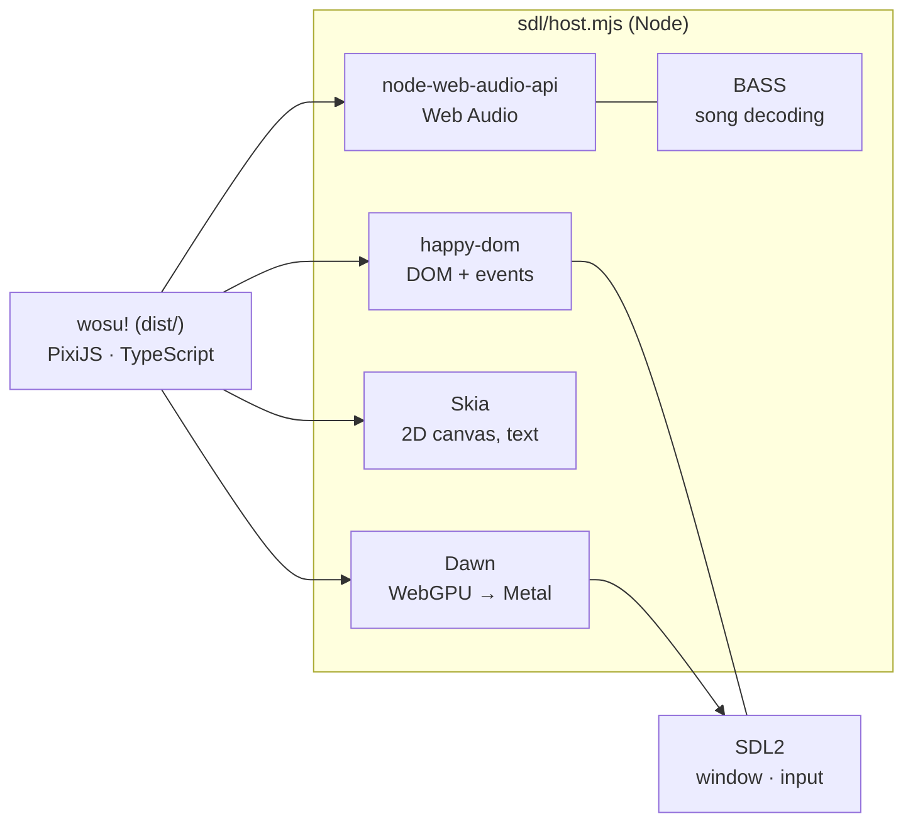

<div align="center">


# wosu!

**An osu!standard client in TypeScript — in your browser, or as a native desktop app that keeps time with osu!lazer.**

[](https://wosu.dino.icu)
[](src)
[](sdl)
[](electron)
[](LICENSE)


<sub>YOASOBI - Yoru ni Kakeru [Keirelia's Insane], mapped by <a href="https://osu.ppy.sh/beatmapsets/1238759">Petal</a> (Autoplay)</sub>

[Features](#-features) · [Desktop app](#%EF%B8%8F-desktop-app) · [Controls](#%EF%B8%8F-controls) · [Getting started](#-getting-started) · [How it works](#-how-it-works) · [Credits](#-credits--licenses)

</div>

---

> [!NOTE]
> wosu! is a fan project. It is not affiliated with or endorsed by ppy, and osu! is a trademark of ppy Pty Ltd.
> Scoring and judgement follow osu!'s rules closely but can still differ; modes other than osu!standard aren't supported yet.

## ✨ Features

<table>
<tr>
<td width="50%" valign="top">

### 🎯 Gameplay
- The full osu!standard loop: circles, sliders, spinners, combos, health, accuracy, grades
- **Stable** or **lazer** judgement mechanics
- Mods: `EZ` `NF` `HT` `DC` `HR` `SD` `PF` `DT` `NC` `HD` `FL` `RX` `AP` `SO` and Autoplay, with lazer's mod customisation
- Pitch-preserving DT/HT (Signalsmith Stretch)
- Replays: record, watch, export `.osr`

</td>
<td width="50%" valign="top">

### 🎨 Presentation
- Storyboards, background video, beatmap skins and hitsounds
- osu!-format skins with a fallback chain
- Full HUD: hit error meter, key overlay, progress, leaderboard, difficulty bars
- Background dim/blur, kiai flashes, hit lighting
- WebGPU (or WebGL) renderer with a GPU slider renderer

</td>
</tr>
<tr>
<td width="50%" valign="top">

### 🎵 Library
- Download beatmaps in-game from mirrors ([Sayobot](https://osu.sayobot.cn), [Mino](https://catboy.best), [NeriNyan](https://nerinyan.moe))
- Import your own `.osz` / `.osk`
- Collections, favourites, local leaderboards
- Star ratings with mods applied

</td>
<td width="50%" valign="top">

### ⏱️ Timing
- Global **and** per-beatmap audio offset
- *Calibrate using last play*, like lazer
- Hitsounds, audio and visuals driven from one smoothed audio clock

</td>
</tr>
</table>

## 🖥️ Desktop app

The same game, without the browser. Everything lives in **`~/.wosu`** (songs, skins, replays, logs, settings), and there are two ways to run it:

| | **Native host** (`sdl/`) | **Electron** (`electron/`) |
| :-- | :-- | :-- |
| Stack | Node + SDL2 + Dawn WebGPU + Skia | Chromium |
| Frame rate | ~900 fps on a MacBook Air | browser-limited |
| Song decoding | **BASS**, like osu! and lazer | Web Audio |
| Extras | own app name and icon, stall log | one-click updates, native menu, media keys, `.osz`/`.osk` file associations |
| Status | the main desktop build | stable |

Both read **your osu!lazer library in place** 📚: beatmaps, skins, collections and scores come straight from lazer's database, with no import. They can also store wosu!'s own beatmaps and scores *in* lazer, writing only while lazer is closed and after making a backup.

<details>
<summary><b>Why the native host keeps time with lazer</b></summary>

<br>

- **Same decoder.** Songs decode with [BASS](https://www.un4seen.com), the library osu! and lazer use (`sdl/vendor/bass`). Song time 0 lands on the exact same sample as in lazer, on every file. Other decoders disagree by 11–22 ms on MP3s without a LAME header.
- **Real output latency.** On macOS a tiny CoreAudio helper (`sdl/audio-latency.swift`) measures what you actually hear: the device's latency plus CoreAudio's double-buffered I/O. It follows device switches (speakers ↔ headphones ↔ Bluetooth).
- **Old maps.** Maps older than format v5 get lazer's +24 ms.
- **Less in memory during play.** Song select is unloaded under gameplay and rebuilt on the way out, covers are dropped, and the background isn't loaded at all at 100% dim.

</details>

> [!TIP]
> Not sure about your offset? Play a map, then hit **Calibrate using last play** on the loading screen (for that beatmap) or in *Settings → Audio* (for all of them).

## ⌨️ Controls

| Action | Keys |
| :-- | :-- |
| Hit | <kbd>Z</kbd> / <kbd>X</kbd>, mouse buttons, or tap |
| Pause | <kbd>Esc</kbd> (or hold the bottom-right button) |
| Skip intro | <kbd>Space</kbd> |
| Quick retry | hold <kbd>`</kbd> |
| Beatmap offset during play | <kbd>-</kbd> / <kbd>=</kbd> (±5 ms, with <kbd>Alt</kbd> ±1 ms) |
| Cycle HUD / peek at HUD | <kbd>Shift</kbd> + <kbd>Tab</kbd> / hold <kbd>Ctrl</kbd> |
| Mods / random beatmap | <kbd>F1</kbd> / <kbd>F2</kbd> |
| Settings / listing / notifications | <kbd>Ctrl</kbd> + <kbd>O</kbd> / <kbd>D</kbd> / <kbd>N</kbd> |
| Volume | <kbd>Alt</kbd> + wheel, <kbd>Alt</kbd> + <kbd>↑</kbd> / <kbd>↓</kbd> |

Gameplay keys can be rebound in *Settings → Input*.

## 🚀 Getting started

> [!IMPORTANT]
> Requires **Node.js 22+**. The desktop builds are developed on macOS; Windows and Linux support is in progress.

**Browser**

```bash
npm install
npm run dev          # dev server with hot reload
```

**Native host**

```bash
npm install && npm run build
cd sdl && npm install
npm start            # runs as "wosu!" with its own icon
```

**Electron**

```bash
npm install
npm run desktop      # builds, then starts Electron as "wosu!"
```

<details>
<summary><b>All scripts</b></summary>

<br>

| Command | What it does |
| :-- | :-- |
| `npm run dev` | Vite dev server with hot reload |
| `npm test` | unit tests (Vitest) |
| `npm run typecheck` | TypeScript, no emit |
| `npm run build` | typecheck + production build into `dist/` |
| `npm run desktop` | build, then the Electron app |
| `npm run desktop:dev` | Electron against the dev server |
| `npm run dist:mac` | packaged macOS build (electron-builder) |
| `cd sdl && npm start` | the native host on the built `dist/` |

`dist/` is plain static files with relative paths, so it can be served from any host or sub-path.

</details>

## 🧩 How it works

The native host gives the built game the slice of a browser it needs, backed by native pieces:



<details>
<summary><b>Project layout</b></summary>

<br>

| Path | What lives there |
| :-- | :-- |
| `src/app` | Pixi application, layers, screen stack, overlays, music controller, background, cursors |
| `src/beatmap` | `.osu` parsing, slider curves, mod processing, `.osz` archives, the library, star ratings |
| `src/gameplay` | Rules and judgement (headless, unit tested), score/health, autoplay, input, hitsounds, drawables, HUD, replays |
| `src/graphics` | GPU slider renderer (WebGL and WebGPU shaders), texture helpers |
| `src/screens` | Intro, main menu, song select, player loader, player, results |
| `src/overlays` | Toolbar, settings, beatmap listing, mod select, notifications, now playing, volume, dialogs |
| `src/ui` | The small UI framework every screen is built from |
| `src/audio` · `src/online` · `src/storage` | Web Audio engine, mirror APIs and downloads, storage |
| `src/native` | The desktop bridge: `~/.wosu`, osu!lazer, updates |
| `sdl/` | Native host: SDL window, Dawn WebGPU, Skia, BASS, CoreAudio latency |
| `electron/` | Electron main process, lazer reader/writer, updater |
| `android/` | Experimental NativeActivity port of the native host (paused) |
| `public/assets` | Skin atlas, cursors, hitsounds, fonts (`art/sprites` holds the atlas sources) |

</details>

See [CONTRIBUTING.md](CONTRIBUTING.md) for bug reports and pull requests.

## 🌱 History

wosu! is the successor to [WebOsu 2](https://github.com/WebOsu-2/webosu-2.github.io), itself a continuation of [the original WebOsu](https://github.com/111116/webosu). The browser version is developed at [mostlime12195/wosu](https://github.com/mostlime12195/wosu); this repository adds the desktop app on top.

## 📜 Credits & licenses

- The code is **MIT** licensed (see [LICENSE](LICENSE)).
- Some media files are copyrighted by [ppy](https://github.com/ppy/) and others; check their licenses before reusing them.
- Cursor textures in `public/assets/skin/cursor/` come from [ppy/osu-resources](https://github.com/ppy/osu-resources), [CC BY-NC 4.0](https://creativecommons.org/licenses/by-nc/4.0/).
- **Exo 2** is under the SIL Open Font License (`public/assets/fonts/Exo2-OFL.txt`).
- **BASS** © Un4seen Developments, [free for non-commercial use](https://www.un4seen.com/bass.html#license) (`sdl/vendor/bass`).
- [Signalsmith Stretch](https://signalsmith-audio.co.uk/code/stretch/) handles pitch-preserving rate changes.

<div align="center">
<br>
<sub>Made with 🩷 for circle clickers.</sub>
</div>
